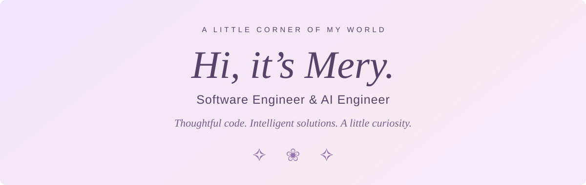

### 01 &nbsp; A little about me 🪻

I build **web applications and AI-powered solutions** with care — focusing on clean architecture, reliable systems, and the details that make them work well.

I’m open to collaborating on web and AI projects where I can contribute, solve meaningful problems, and keep growing.

### 02 &nbsp; Tools I work with ✨

**Frontend**

**Backend**

**AI & Data**

**Also in my toolkit**

### 03 &nbsp; Beyond the code 🌷

> I’m learning Korean while building software. 
> Two different languages. The same curiosity.

---

*Built with care. Always growing. ♡*

